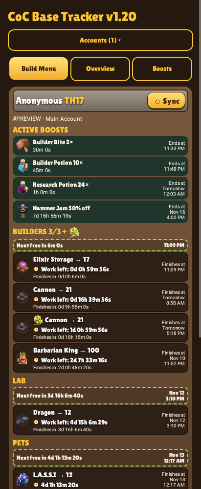
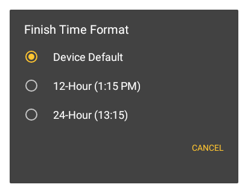
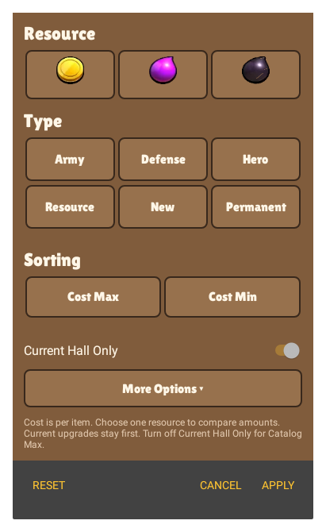
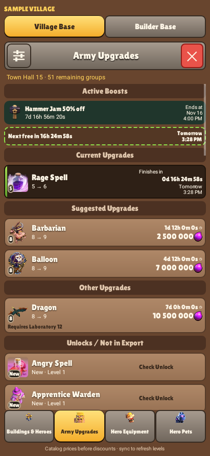
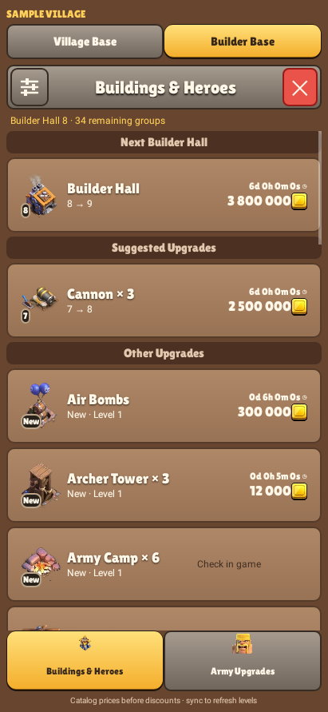
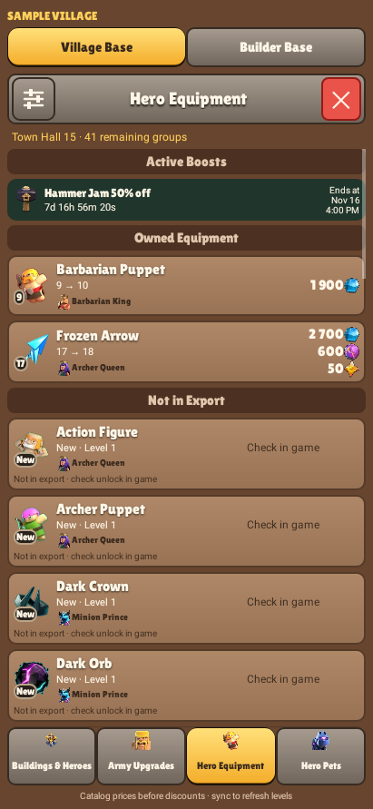

# CoC Base Tracker

Upgrade timers, village planning, and account-specific home screen widgets for Clash of Clans.

[](https://github.com/MasteR-NY/CoC-Base-Tracker/releases/latest)

**Android 8.0+ · Kotlin App · Offline Tracking · Multiple Accounts**

Download the `.apk` file under **Assets** on the latest release page. When updating, install over your existing version to keep your saved accounts and widgets.

## Design Previews

| Upgrade Timers | Build Menu | Home Screen Widget |
| --- | --- | --- |
|  |  |  |

*Previews show the current compact layouts with the sample name Anonymous. Sample data is separate from your saved accounts. Widget appearance may vary by launcher.*

<details>
<summary>Village Overview Previews</summary>

| Base Progress | Crafting Modules |
| --- | --- |
|  |  |

| Helper Availability | Equipment Collection | Cosmetics |
| --- | --- | --- |
|  |  |  |

</details>

## Features

- Automatic import of fresh village exports when returning to the app, with a manual-sync option.
- Scrollable home screen widgets with live countdowns in days, hours, minutes, and seconds.
- Upgrade tracking and finish reminders for builders, research, pets, and both bases.
- Upgrade planning with level requirements, baseline costs, and durations.
- Resource, type, hero, and status filters, with cost, time, and name sorting.
- Multiple accounts with in-game names, optional nicknames, and independent widgets.
- An offline What’s New guide with release highlights and usage instructions.
- Base progress, crafting modules, equipment and cosmetic collection views.
- Helper and Clock Tower availability alerts with account-specific deadlines.
- Bundled names and artwork for crafting modules, helpers and cosmetic collections.

## Getting Started

1. Download and install the APK from the [latest release](https://github.com/MasteR-NY/CoC-Base-Tracker/releases/latest).
2. In Clash of Clans, open **Settings → More Settings → Export village data** and copy the export. Menu wording may vary by game version or language.
3. Open CoC Base Tracker. **Auto-sync on return** imports a fresh export automatically; **Sync / Add Account** is available for manual import.
4. Enter the account's in-game name if prompted. You can edit it later under **Settings → In-game Name**.
5. Tap **Add widget** and choose an account, or add CoC Base Tracker from your launcher's widget picker.

The sample village uses **Anonymous** as its display name. Your own account names remain independent and can be edited in Settings. A small **Goblin head** marks an extra hired-worker upgrade; the same icon beside a queue heading shows hired work is running. These jobs do not occupy permanent builder slots.

Allow notifications for upgrade-finished alerts and the live widget controls. On Android 12 and later, **Allow precise timers** helps finish alerts arrive on time.

### How Sync Works

1. **Copy an export in Clash.** Its timestamp records the age of the snapshot, along with the upgrades and effects supplied by the game.
2. **Return to the tracker.** Auto-sync imports a fresh, valid export while the app has focus. You can turn this off and use Sync manually. A widget’s Sync button keeps its selected account protected.
3. **Let the timers run.** Remaining time is calculated on your phone from the export timestamp, including supported boost windows and helper assignments.

Copy another export after starting or canceling an upgrade, using a Magic Item, changing a helper assignment or finishing an upgrade early. Copying alone cannot wake or redirect to the tracker. The app must be opened or focused to read the new clipboard text.

### Battery and Notification Settings

The live widget notification is expected while readable widget countdowns are enabled. It updates visible timers while the phone is awake; screen-off and lock-screen pauses are intentional and do not lose elapsed time.

If finish reminders arrive late, check:

- **Settings in the app:** enable Notifications and, when needed, Helper & Clock Tower alerts.
- **Android app settings:** allow notifications. On Android 12 and later, allow precise timers from the app’s Settings.
- **Battery settings:** if your phone restricts the tracker, select Unrestricted or the equivalent option for this app. Enable Auto-start if your phone provides that control and reminders stop after reboot.

Menu names vary by manufacturer. After force-stopping the app, open it again to restore reminders. Turning off Live readable widget timers uses Android’s native clock-style countdowns; the custom d/h/m/s service is then stopped.

### Checking for Updates

The app header shows the installed version, for example **CoC Base Tracker v1.20**. Scroll to the bottom and tap **Check for Updates** to compare it with the latest stable GitHub release.

If your version is current, the app confirms that you are up to date. For a newer release, choose **Download Update** to download the APK inside the app. Once the file passes verification, tap **Install Update**. Android may ask you to allow installs from CoC Base Tracker; return to the app afterward and tap Install Update again to open Android’s confirmation screen. Install over your existing version to retain accounts and widgets.

Certificate checks read both modern and legacy Android signing records. An unavailable certificate is reported separately from a different key; neither is accepted without verification. A blocked download offers **Certificate Details**, with installed/downloaded SHA-256 fingerprints and an explicit Copy Details action.

If an older app version incorrectly blocks this update, download the APK from Releases and open it through your file manager once. Install over the existing app; keep its data intact. If Android itself rejects the signature, use an APK signed with the installed app’s original key. See [Signing Checks](docs/SIGNING-CHECKS.md).

Downloads continue when you leave the screen. Use **Update Download** or the ready notification to return. Notifications are optional. You can cancel a download or delete a completed one.

If the GitHub API fails, the app tries the public latest-release redirect. If Android blocks the app’s connections, Android Downloads tries the public release page before the API. A temporary server failure gets one retry; denied or rate-limited requests do not. A verified release tag can be offered while its APK availability is checked during download.

Failures show a short explanation; expand **Technical Details** for the system message. **Retry** and **Open Releases** remain available. HTTP 403 means access was denied or limited, and HTTP 504 means a gateway timed out; neither proves the phone is offline. An Android `EPERM` socket restriction may still require a phone setting change. Checks run only when requested; a download starts after you choose it.

<details>
<summary>Preview the Update Screen</summary>


*Sample update version shown for illustration.*

</details>

### What’s New

After installing or updating, a short summary introduces the release. Tap **Read Guide** for the changes and instructions, or **Got It** to dismiss the summary for that version.

The **What’s New** button at the bottom of the app reopens the guide anytime. Earlier releases can be expanded individually, and the entire guide works offline. The same notes are available in the [Release Notes](CHANGELOG.md).

<details>
<summary>Preview the What’s New Guide</summary>


</details>

### Keeping Your Village Current

Timers run from your most recent village export and continue counting down when Clash is closed. Import a fresh export after starting an upgrade, finishing one early, using a potion, or changing helper assignments. New activity in Clash appears after you sync.

With **Auto-sync on return** enabled, copy the export in Clash and switch back to the tracker. A new valid export imports without tapping Sync. Duplicate and older snapshots are ignored, and each widget keeps its account selection. Turn the option off in **Settings** to use manual import. Android does not allow the tracker to watch Clash’s Copy button in the background or automatically redirect you from it; returning to the app gives it clipboard access. See [Village Export Data](docs/EXPORT-DATA.md) for the field reference and platform limits.

Active potions, upgrade-speed Magic Snacks, Clock Tower boosts, and assigned helpers are included in the timer calculations. In the app and Build Menu, boosted upgrades show their work rate, a smooth accelerated **Work left** countdown, and estimated real **Finishes in** time. A 24× boost advances work through intermediate seconds instead of subtracting 24 seconds in one jump. Widgets show estimated real time remaining in steady seconds, with boosts grouped above the upgrades. Open **Boosts** to review the effects recorded in your export.

Additional doses extend boost duration. Known repeating helper assignments are forecast when their assignment and cooldown are included in the export. Books, Hammers and other instant finishes appear after a fresh sync; unused chest rewards and combat/resource boosts do not accelerate upgrade timers. See [Timer Rules](docs/TIMING.md) for supported effects and examples.

### Finish Times and Active Boosts

Current upgrades show an estimated **Finishes at** clock beside their countdown. Tomorrow and later dates are labeled, and times use your phone’s timezone. Choose **Settings → Time Format → Device Default, 12-Hour, or 24-Hour**. This applies to the app, Build Menu and home widgets.

**Active Boosts** appears above the upgrade sections. Each active potion, snack or Clock Tower boost has its icon, name, rate, remaining duration and local **Ends at** time. A bundled, dated event can appear with its published deadline; Hammer Jam is labeled **50% off**, with no second discount applied to exported work. Study Soup shows **+3×** because it adds speed to compatible potion effects. Both Builder Bite and Builder Potion remain listed when active; the potion’s priority is preserved in the timer calculation. Individual upgrade rows no longer repeat potion/snack names.

When all regular slots in a queue are busy, **Next free in** shows the wait and local availability clock. Regular builders, Laboratory, Pet House, Builder Base builders and Star Laboratory are evaluated separately. Goblin jobs do not count as regular builder availability. Times are estimates from the last export; sync after changing an upgrade, potion or helper assignment.

The widget scrolls boosts and upgrades together. Active boost/event timers can keep the existing live-timer notification running after the last upgrade finishes; updates still pause while the screen is off or locked.

<details>
<summary>Finish Clock and Availability Previews</summary>

| All Builders Busy | Time Format Settings |
| --- | --- |
|  |  |

</details>

### Settings and Help

Tap **Settings** to expand auto-sync, account names, nicknames, live widget timers and notification controls. The panel starts collapsed to leave more room for upgrades and is available before the first import. **Help & About** contains sync instructions, timer explanations, widget guidance, privacy details and credits.

## Multiple Accounts and Widgets

Import an export from each account, then use **Accounts** to switch between them. Each home screen widget keeps its own account selection. Tap **▾** beside a widget's Sync button to change it.

In-game names and optional nicknames such as Main or Mini are saved per player tag. If an export omits the name, enter it once in the app. Names stay saved across later syncs. Editing an account label here does not change your name in Clash of Clans.

## Live Widget Timers

**Live readable widget timers** is enabled by default. An ongoing notification keeps the formatted countdowns updating while the app is closed. Display updates pause when the screen is off or locked and recalculate when you unlock your phone.

Choose **Pause live updates** in the notification to use Android's clock-style widget timer. Turn **Live readable widget timers** back on in Settings to restore the days, hours, minutes, and seconds format.

If Android stops background updates or you force-stop the app, reopen it to restore tracking. Your launcher's widget support and Android battery settings can affect updates and alert timing.

## Build Menu

| Base | Upgrade Categories |
| --- | --- |
| Village Base | Buildings & Heroes, Army Upgrades, Hero Equipment, Hero Pets |
| Builder Base | Buildings & Heroes, Army Upgrades |

Version 1.18 corrects Monolith Arrow’s equipment ID and the TH12 requirements for Stone Slammer’s first three levels. A level-17 Monolith Arrow now shows its level-18 upgrade under Archer Queen equipment. See [Catalog Corrections](docs/CATALOG-CORRECTIONS.md) for the reviewed mappings.

The menu opens with **Current Hall Only** enabled. It shows running upgrades first, remaining upgrades reachable within your current Town Hall or Builder Hall, and the next hall upgrade. A required Laboratory, Hero Hall, or other facility upgrade stays listed when it can be completed at the current hall. Future hall requirements are hidden by default. Turn off Current Hall Only in the sliders menu to inspect next steps beyond that hall.

Upgrade rows show the target level’s artwork, the exported current level on the badge, and costs with resource or ore icons on the right. Buildings and walls at the same level are grouped; prices and times are per item. Active countdowns stay in days, hours, minutes, and seconds. The app and widgets also use destination-level artwork for running upgrades.

The sliders menu has **Resource** and **Type** buttons, **Cost Max** and **Cost Min**, and hero portraits for equipment. Builder Base army upgrades use the simpler cost-sorting panel. Filters stay separate for each base/category, survive screen recreation, and are applied only when you tap Apply. Cancel discards edits; Reset restores current-hall defaults. An empty match does not silently reset your choices.

The default order offers up to three owned, requirement-met upgrades with the shortest baseline durations, followed by the other remaining upgrades. These are local suggestions. Equipment is grouped as Owned Equipment and Not in Export; equipped status is not inferred. Missing army items appear separately as unlock checks.

<details>
<summary>Build Menu Previews</summary>

| Resource and Type Filters | Army Upgrades |
| --- | --- |
|  |  |

| Builder Base | Hero Equipment |
| --- | --- |
|  |  |

</details>

Planning costs and durations are baseline values. Event discounts, Gold Pass benefits, potions, and helpers may change the in-game quote. Listed requirements do not account for your available resources or free builders.

The offline catalog covers standard levels through **Town Hall 18** and **Builder Hall 10**. Supercharges, some crafted modules, merge recipes, and other special conditions require confirmation in game. See the [Upgrade Planner Reference](docs/UPGRADE-PLANNER.md) for coverage and limitations.

## Village Overview

Tap **Overview** beside Build Menu to open the account’s **Progress**, **Crafting**, **Helpers** and **Collection** views. Switch between Village Base and Builder Base at the top.

Progress compares exported levels and quantities with **Current Hall** or **Catalog Max** targets. Crafting includes all exported modules, including the nine in the supplied sample. Collection shows equipment levels and owned cosmetics, with quantities for grouped decorations and obstacles. Unverified names and caps remain clearly marked.

Helpers lists exported cooldown estimates; Builder Base shows Clock Tower availability. **Helper & Clock Tower alerts** sends a one-time reminder for each exported deadline when notifications are enabled. Sync after using either in game to replace the old estimate. The **News** button opens dated notes and links to Supercell’s official sources; included notes work offline.

See [Village Overview](docs/OVERVIEW.md) for calculation details and [Official Game Data References](docs/GAME-DATA.md) for the sources reviewed with this release.

## Privacy

Upgrade tracking and planning work offline. Village exports and account labels are stored on your device, with system cloud backup disabled. No Supercell login, password, or verification code is required.

Internet access is used for requested update checks and APK downloads from this repository’s GitHub releases. Android’s download service provides a fallback for metadata and handles approved APK downloads, including GitHub’s asset-host redirects. Requests include the app version but no village exports, account names, player tags, or login credentials. GitHub receives normal connection information such as your IP address. The optional **Open Releases** button uses your browser.

Update files are checked for the app’s package, newer version and matching signing key; GitHub’s SHA-256 digest is checked when available. The **Install unknown apps** permission enables Android’s installer for these updates. Installation still requires your confirmation. No broad storage permission is requested.

There is no advertising or analytics. Clipboard text is read when you tap Sync or while the tracker has focus with **Auto-sync on return** enabled. Unrelated text is ignored, clipboard URIs are never opened, and the widget service does not monitor the clipboard. Saved accounts can be removed from Settings.

### Permissions

| Permission | Purpose |
| --- | --- |
| Internet | User-requested GitHub release checks and update downloads; tracking and planning use local data |
| Notifications | Upgrade-finished, helper availability and update-ready alerts, plus live widget controls |
| Schedule Exact Alarms | Prompt finish alerts and timer-expiry refreshes when allowed by Android |
| Receive Boot Completed | Restore local alarm scheduling after reboot |
| Foreground Service / Special Use | Keep readable widget countdowns updating with an ongoing notification while the screen is on |
| Request Install Packages | Open Android’s installer for an explicitly downloaded and verified app update |

Android asks separately for notification, exact-alarm and installation access where required. Permission to install updates does not allow silent installation. The app requests no broad storage, accessibility or screen-recording access. See the [Android manifest](app/src/main/AndroidManifest.xml) for the declared permissions.

## Troubleshooting

| Problem | What to Check |
| --- | --- |
| An upgrade is missing or its finish estimate changed | Copy a fresh export, confirm the selected account and base, and check Build Menu filters. Current Hall Only hides upgrades that need a later hall. |
| A timer differs from Clash | Confirm the export is recent. Work left is accelerated upgrade work; Finishes in is real estimated time. Recurring helper forecasts depend on the exported assignment continuing. |
| Sync ignores the clipboard | Copy the export again and return to the tracker. Unrelated text, duplicate snapshots and older snapshots are ignored. A widget rejects a different account’s export; add it from the app instead. |
| The widget stops ticking | Confirm Live readable widget timers is enabled and open the app once. Check the ongoing notification and battery restrictions. Screen-off pauses are expected. |
| A row has an unknown ID or missing artwork | Report the item ID, its level and the app version. Unknown records keep their IDs rather than receiving a guessed name or image. |
| Update checking returns 403 or 504 | A denied/limited request or gateway timeout can occur while internet access still works. Wait before retrying. Expand Technical Details or use Open Releases. |
| Technical Details contains EPERM | Android denied the app’s direct socket access. Check app network restrictions or VPN/firewall settings; the system-service fallback may also be restricted. |
| A new release has no APK yet | Wait for its asset upload to finish. Release publishers should attach the versioned signed APK before publishing the release. |

When reporting a problem, include the installed app version, Android version, affected base/item and the relevant technical error. Redact account details from screenshots and avoid posting a complete personal export. Reports can be filed in this repository’s [Issues](https://github.com/MasteR-NY/CoC-Base-Tracker/issues).

## Frequently Asked Questions

**Does tracking require a Supercell login or API key?**  
No. Import the text copied by the game’s export feature. Never provide your Supercell password or verification code to the tracker.

**Can it discover a new upgrade while Clash is closed?**  
Existing timers continue locally. New in-game activity needs a new export; there is no background connection to your village.

**Can I add potions or assign helpers from the tracker?**  
Apply them in Clash, then import a fresh export. This release calculates the effects supplied by the snapshot; it does not perform those actions in the game.

**Does it support Builder Base and multiple accounts?**  
Yes. Switch bases in Build Menu or Overview. Import each account separately and choose an account for each widget.

**Will an update keep my saved villages?**  
Install the signed APK over the existing app. The package, signing identity, preference keys and export-file format are preserved, including through the Kotlin migration. Uninstalling or clearing app storage removes local data; cloud backup is disabled.

**Is this an official Supercell app?**  
No. It is a fan companion that reads exported data. It does not log into or modify the game. See the credits and Supercell Fan Content Policy below.

## Building From Source

All 37 maintained production app source files are Kotlin, including Main, Build Menu and Overview. Existing Java regression tests remain to check behavior and interoperability. The Android Gradle plugin provides built-in Kotlin support. The app targets JVM 17 bytecode, with Android 8.0 as the minimum supported platform.

Install **JDK 21+**, **Gradle 9.7.1**, Android **SDK Platform 37** and **Build Tools 36.0.0+**. Set `JAVA_HOME` and `ANDROID_HOME`, then run from the project folder:

```powershell
gradle --no-daemon :app:testDebugUnitTest :app:lintRelease
powershell -File .\build.ps1
```

The normal build runs tests, renders README previews, checks lint, assembles and signs the APK. It writes `outputs/CoC-Base-Tracker-<version>.apk`. The script accepts `-JavaHome` and `-GradlePath` if those tools are not on PATH.

The first local release build creates a signing key under `.private/`. Keep it backed up and out of Git. A source recipient’s new key produces a separate signing identity and cannot update the distributed APK. For this project’s future releases, keep the original key and increase both the version code and release version. See the [Build and Release Guide](docs/DEVELOPMENT.md) for packaging and publication.

| Path | Contents |
| --- | --- |
| `app/src/main/java/com/villageclock/app/*.kt` | All production app code: screens, tracking, storage, planning, widgets, services and updates |
| `app/src/main/assets/` | Offline game catalogs, release notes and source notices |
| `app/src/main/res/` | Native layouts, fonts, artwork and icons |
| `app/src/test/` | Timing, import, account, update and Android framework regression tests |
| `tools/` | Reviewed catalog/artwork maintenance and release packaging scripts |
| `docs/` | Usage references, development notes, credits and current previews |

## Documentation

- [Release Notes](CHANGELOG.md)
- [Village Export Data and Feature Possibilities](docs/EXPORT-DATA.md)
- [Village Overview](docs/OVERVIEW.md)
- [Official Game Data References](docs/GAME-DATA.md)
- [Item Names and Artwork](docs/ITEM-IDENTITIES.md)
- [Timer Rules](docs/TIMING.md)
- [Upgrade Planner Reference](docs/UPGRADE-PLANNER.md)
- [Build and Release Guide](docs/DEVELOPMENT.md)
- [Kotlin Migration](docs/KOTLIN-MIGRATION.md)
- [Signing Checks and Release Certificates](docs/SIGNING-CHECKS.md)
- [Preview Maintenance](docs/DESIGN-PREVIEWS.md)
- [Credits and Third-Party Resources](docs/DESIGN-CREDITS.md)

## Credits

Original application code is available under the [MIT License](LICENSE). The presentation draws on [Coc-Widget](https://github.com/Yusuf-Bedri-Bitiren/Coc-Widget); game artwork, fonts, and other third-party resources retain their respective terms. Full attribution is in [Credits and Third-Party Resources](docs/DESIGN-CREDITS.md). Setup and troubleshooting topics were informed by the [Clash Timers README](https://github.com/Kuswaa/clash-timers); the instructions above describe CoC Base Tracker’s own behavior and permissions.

CoC Base Tracker is an unofficial fan project and is not affiliated with or endorsed by Supercell. Clash of Clans and its related assets belong to Supercell. See [Supercell's Fan Content Policy](https://supercell.com/en/fan-content-policy/).
