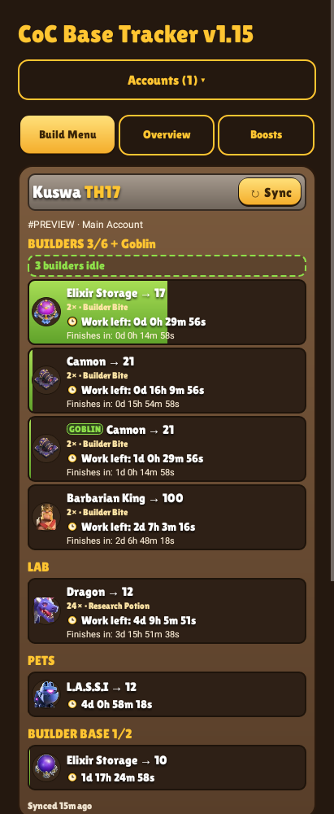
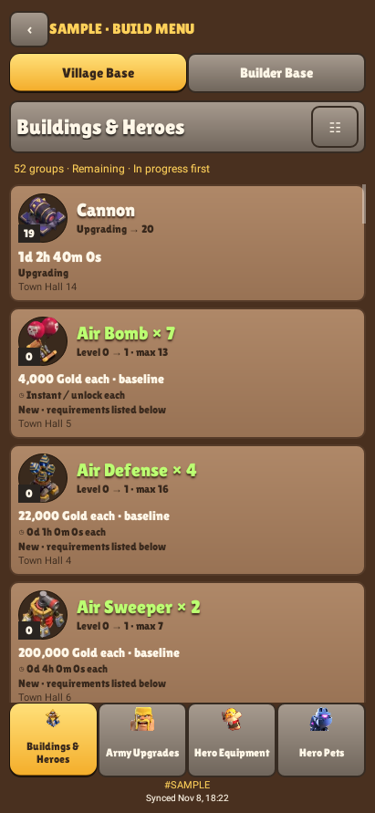
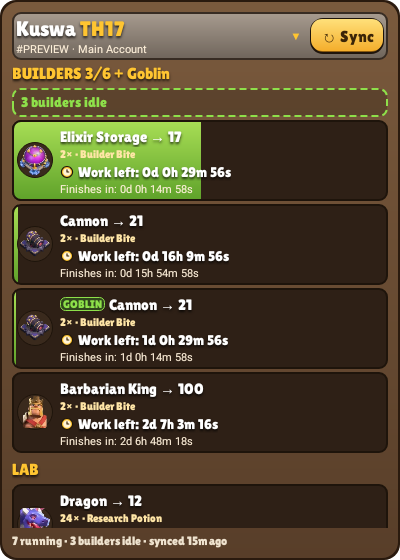
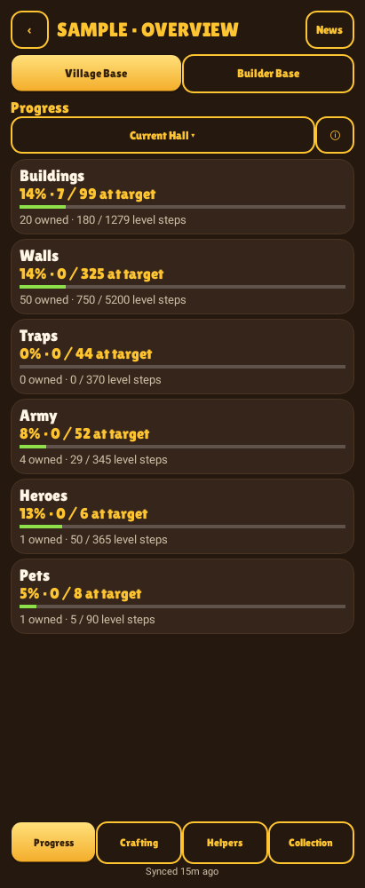
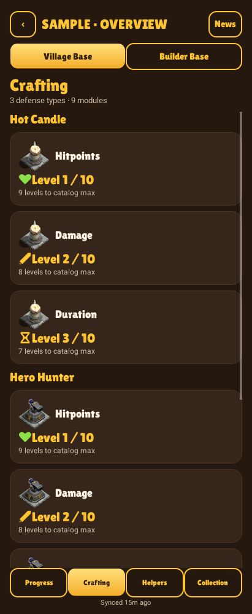
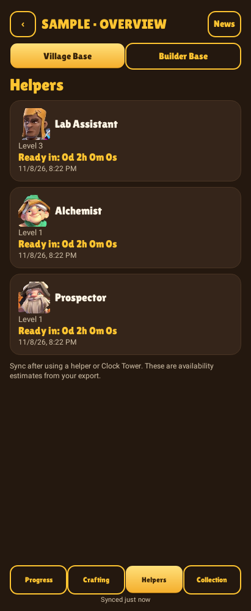
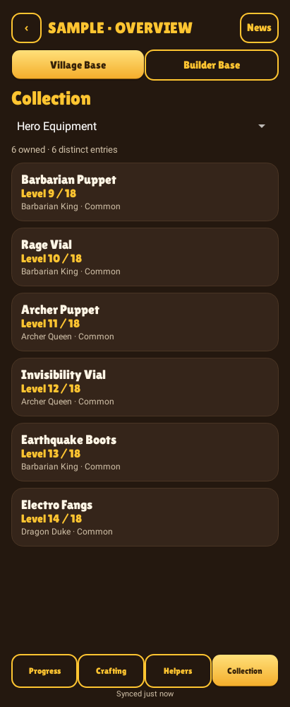
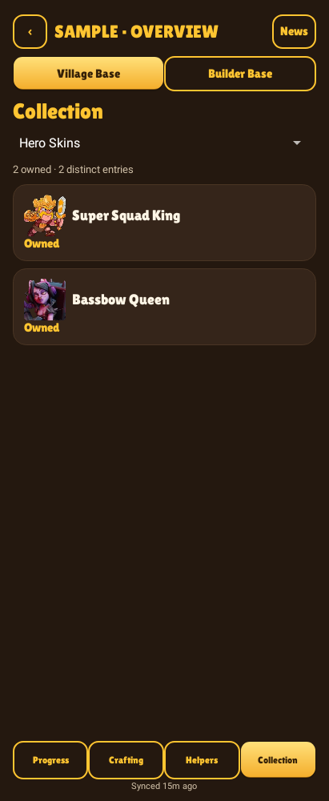
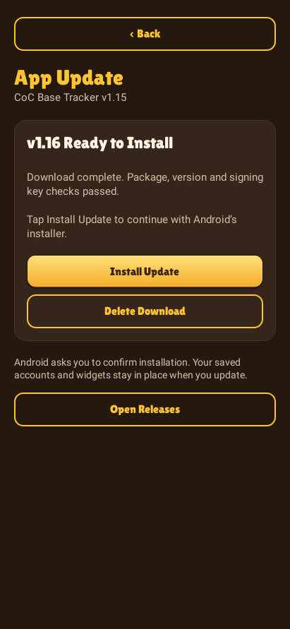
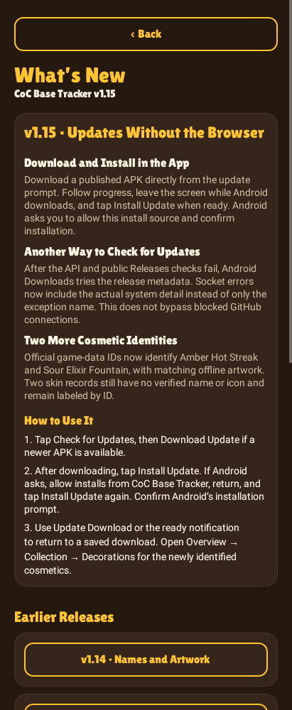

# CoC Base Tracker

Upgrade timers, village planning, and account-specific home screen widgets for Clash of Clans.

**Android 8.0+ · Offline Tracking · Multiple Accounts**

Download the `.apk` file under **Assets** on the latest release page. When updating, install over your existing version to keep your saved accounts and widgets.

## Design Previews

| Upgrade Timers | Build Menu | Home Screen Widget |
| --- | --- | --- |
|  |  |  |

*Previews use sample account data. Widget appearance may vary by launcher.*

Village Overview Previews

| Base Progress | Crafting Modules |
| --- | --- |
|  |  |

| Helper Availability | Equipment Collection | Cosmetics |
| --- | --- | --- |
|  |  |  |

## Features

- Automatic import of fresh village exports when returning to the app, with a manual-sync option.
- Scrollable home screen widgets with live countdowns in days, hours, minutes, and seconds.
- Upgrade tracking and finish reminders for builders, research, pets, and both bases.
- Upgrade planning with level requirements, baseline costs, and durations.
- Resource, type, hero, and status filters, with cost, time, and name sorting.
- Multiple accounts with in-game names, optional nicknames, and independent widgets.
- An offline What’s New guide with release highlights and usage instructions.
- Base progress, crafting modules, equipment and cosmetic collection views.
- Helper and Clock Tower availability alerts with account-specific deadlines.
- Bundled names and artwork for crafting modules, helpers and cosmetic collections.

## Getting Started

1. Download and install the APK from the [latest release](https://github.com/MasteR-NY/CoC-Base-Tracker/releases/latest).
2. In Clash of Clans, open **Settings → More Settings → Export village data** and copy the export. Menu wording may vary by game version or language.
3. Open CoC Base Tracker. **Auto-sync on return** imports a fresh export automatically; **Sync / Add Account** is available for manual import.
4. Enter the account's in-game name if prompted. You can edit it later under **Settings → In-game Name**.
5. Tap **Add widget** and choose an account, or add CoC Base Tracker from your launcher's widget picker.

Allow notifications for upgrade-finished alerts and the live widget controls. On Android 12 and later, **Allow precise timers** helps finish alerts arrive on time.

### Checking for Updates

The app header shows the installed version, for example **CoC Base Tracker v1.15**. Scroll to the bottom and tap **Check for Updates** to compare it with the latest stable GitHub release.

If your version is current, the app confirms that you are up to date. For a newer release, choose **Download Update** to download the APK inside the app. Once the file passes verification, tap **Install Update**. Android may ask you to allow installs from CoC Base Tracker; return to the app afterward and tap Install Update again to open Android’s confirmation screen. Install over your existing version to retain accounts and widgets.

Downloads continue when you leave the screen. Use **Update Download** or the ready notification to return. Notifications are optional. You can cancel a download or delete a completed one.

If the GitHub API fails, the app tries the public latest-release redirect, followed by Android’s download service for metadata if both app connections fail. Error details include the system’s socket message. **Retry** and **Open Releases** remain available when GitHub cannot be reached. Checks run only when requested; a download starts after you choose it.

Preview the Update Screen

*Sample update version shown for illustration.*

### What’s New

After installing or updating, a short summary introduces the release. Tap **Read Guide** for the changes and instructions, or **Got It** to dismiss the summary for that version.

The **What’s New** button at the bottom of the app reopens the guide anytime. Earlier releases can be expanded individually, and the entire guide works offline. The same notes are available in the [Release Notes](CHANGELOG.md).

Preview the What’s New Guide

### Keeping Your Village Current

Timers run from your most recent village export and continue counting down when Clash is closed. Import a fresh export after starting an upgrade, finishing one early, using a potion, or changing helper assignments. New activity in Clash appears after you sync.

With **Auto-sync on return** enabled, copy the export in Clash and switch back to the tracker. A new valid export imports without tapping Sync. Duplicate and older snapshots are ignored, and each widget keeps its account selection. Turn the option off in **Settings** to use manual import. Android does not allow the tracker to watch Clash’s Copy button in the background or automatically redirect you from it; returning to the app gives it clipboard access. See [Village Export Data](docs/EXPORT-DATA.md) for the field reference and platform limits.

Active potions, upgrade-speed Magic Snacks, Clock Tower boosts, and assigned helpers are included in the timer calculations. In the app and Build Menu, boosted upgrades show their work rate, a smooth accelerated **Work left** countdown, and estimated real **Finishes in** time. A 24× boost advances work through intermediate seconds instead of subtracting 24 seconds in one jump. Widgets show the estimated real time remaining in steady seconds, alongside a boost badge. Open **Boosts** to review the effects recorded in your export.

Additional doses extend boost duration. Known repeating helper assignments are forecast when their assignment and cooldown are included in the export. Books, Hammers and other instant finishes appear after a fresh sync; unused chest rewards and combat/resource boosts do not accelerate upgrade timers. See [Timer Rules](docs/TIMING.md) for supported effects and examples.

### Settings and Help

Tap **Settings** to expand auto-sync, account names, nicknames, live widget timers and notification controls. The panel starts collapsed to leave more room for upgrades and is available before the first import. **Help & About** contains sync instructions, timer explanations, widget guidance, privacy details and credits.

## Multiple Accounts and Widgets

Import an export from each account, then use **Accounts** to switch between them. Each home screen widget keeps its own account selection. Tap **▾** beside a widget's Sync button to change it.

In-game names and optional nicknames such as Main or Mini are saved per player tag. If an export omits the name, enter it once in the app. Names stay saved across later syncs. Editing an account label here does not change your name in Clash of Clans.

## Live Widget Timers

**Live readable widget timers** is enabled by default. An ongoing notification keeps the formatted countdowns updating while the app is closed. Display updates pause when the screen is off or locked and recalculate when you unlock your phone.

Choose **Pause live updates** in the notification to use Android's clock-style widget timer. Turn **Live readable widget timers** back on in Settings to restore the days, hours, minutes, and seconds format.

If Android stops background updates or you force-stop the app, reopen it to restore tracking. Your launcher's widget support and Android battery settings can affect updates and alert timing.

## Build Menu

| Base | Upgrade Categories |
| --- | --- |
| Village Base | Buildings & Heroes, Army Upgrades, Hero Equipment, Hero Pets |
| Builder Base | Buildings & Heroes, Army Upgrades |

Tap an upgrade card to view its next level, listed requirements, baseline cost, and duration. Buildings and walls at the same level are grouped together; prices and durations are shown per item. Resource, type, and hero filters help narrow the list.

Planning costs and durations are baseline values. Event discounts, Gold Pass benefits, potions, and helpers may change the in-game quote. Listed requirements do not account for your available resources or free builders.

The offline catalog covers standard levels through **Town Hall 18** and **Builder Hall 10**. Supercharges, some crafted modules, merge recipes, and other special conditions require confirmation in game. See the [Upgrade Planner Reference](docs/UPGRADE-PLANNER.md) for coverage and limitations.

## Village Overview

Tap **Overview** beside Build Menu to open the account’s **Progress**, **Crafting**, **Helpers** and **Collection** views. Switch between Village Base and Builder Base at the top.

Progress compares exported levels and quantities with **Current Hall** or **Catalog Max** targets. Crafting includes all exported modules, including the nine in the supplied sample. Collection shows equipment levels and owned cosmetics, with quantities for grouped decorations and obstacles. Unverified names and caps remain clearly marked.

Helpers lists exported cooldown estimates; Builder Base shows Clock Tower availability. **Helper & Clock Tower alerts** sends a one-time reminder for each exported deadline when notifications are enabled. Sync after using either in game to replace the old estimate. The **News** button opens dated notes and links to Supercell’s official sources; included notes work offline.

See [Village Overview](docs/OVERVIEW.md) for calculation details and [Official Game Data References](docs/GAME-DATA.md) for the sources reviewed with this release.

## Privacy

Upgrade tracking and planning work offline. Village exports and account labels are stored on your device, with system cloud backup disabled. No Supercell login, password, or verification code is required.

Internet access is used for requested update checks and APK downloads from this repository’s GitHub releases. Android’s download service provides a fallback for metadata and handles approved APK downloads, including GitHub’s asset-host redirects. Requests include the app version but no village exports, account names, player tags, or login credentials. GitHub receives normal connection information such as your IP address. The optional **Open Releases** button uses your browser.

Update files are checked for the app’s package, newer version and matching signing key; GitHub’s SHA-256 digest is checked when available. The **Install unknown apps** permission enables Android’s installer for these updates. Installation still requires your confirmation. No broad storage permission is requested.

There is no advertising or analytics. Clipboard text is read when you tap Sync or while the tracker has focus with **Auto-sync on return** enabled. Unrelated text is ignored, clipboard URIs are never opened, and the widget service does not monitor the clipboard. Saved accounts can be removed from Settings.

## Documentation

- [Release Notes](CHANGELOG.md)
- [Village Export Data and Feature Possibilities](docs/EXPORT-DATA.md)
- [Village Overview](docs/OVERVIEW.md)
- [Official Game Data References](docs/GAME-DATA.md)
- [Item Names and Artwork](docs/ITEM-IDENTITIES.md)
- [Timer Rules](docs/TIMING.md)
- [Upgrade Planner Reference](docs/UPGRADE-PLANNER.md)
- [Build and Release Guide](docs/DEVELOPMENT.md)
- [Preview Maintenance](docs/DESIGN-PREVIEWS.md)
- [Credits and Third-Party Resources](docs/DESIGN-CREDITS.md)

## Credits

Original application code is available under the [MIT License](LICENSE). The presentation draws on [Coc-Widget](https://github.com/Yusuf-Bedri-Bitiren/Coc-Widget); game artwork, fonts, and other third-party resources retain their respective terms. Full attribution is in [Credits and Third-Party Resources](docs/DESIGN-CREDITS.md).

CoC Base Tracker is an unofficial fan project and is not affiliated with or endorsed by Supercell. Clash of Clans and its related assets belong to Supercell. See [Supercell's Fan Content Policy](https://supercell.com/en/fan-content-policy/).
